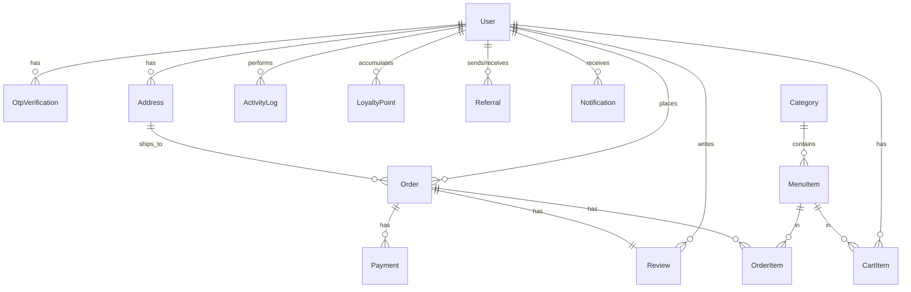

# Database Schema - Karachi Naseeb Baryani & Pulao UCP

This document outlines the PostgreSQL (Supabase) database schema definition, field descriptions, and relations used in the platform, managed via Prisma ORM.

---

## 1. Relational Map (Prisma Entity Relationships)

---

## 2. Table Schemas & Dictionary

### A. Users Table (`users`)
Stores profile information, authentication indicators, roles, and marketing/loyalty metrics.

| Column | Type | Attributes | Description |
|---|---|---|---|
| `id` | VARCHAR(191) | PK, UUID | Unique user identifier. |
| `name` | VARCHAR(191) | NOT NULL | Full name of the user. |
| `email` | VARCHAR(191) | UNIQUE, NULLABLE | Optional login email. |
| `phone` | VARCHAR(191) | UNIQUE, NOT NULL | Mobile number (used as primary ID for logins). |
| `passwordHash` | VARCHAR(191) | NULLABLE | Bcrypt hashed password. |
| `role` | ENUM('CUSTOMER', 'ADMIN') | DEFAULT 'CUSTOMER' | Authorization role. |
| `phoneVerified` | BOOLEAN | DEFAULT false | Set to `true` after successful OTP verification. |
| `googleId` | VARCHAR(191) | UNIQUE, NULLABLE | Google OAuth account identifier. |
| `profilePicture` | VARCHAR(191) | NULLABLE | CDN/local URL of the user's avatar. |
| `referralCode` | VARCHAR(191) | UNIQUE, NULLABLE | Unique user referral code. |
| `loyaltyPoints` | INT | DEFAULT 0 | Current wallet balance of loyalty points. |
| `blockedAt` | DATETIME | NULLABLE | Timestamp of administrative block (if customer is suspended). |
| `createdAt` | DATETIME | DEFAULT NOW() | Registration date. |
| `updatedAt` | DATETIME | ON UPDATE NOW() | Auto-updating timestamp. |

---

### B. Otp Verifications Table (`otp_verifications`)
Stores temporary six-digit security codes for phone login validation and password resets.

| Column | Type | Attributes | Description |
|---|---|---|---|
| `id` | VARCHAR(191) | PK, UUID | Unique verification tracking ID. |
| `userId` | VARCHAR(191) | FK (`users.id`), Cascade | Owner of the verification code. |
| `otpCode` | VARCHAR(191) | NOT NULL | Hashed or plaintext OTP value. |
| `purpose` | VARCHAR(191) | NOT NULL | Purpose code: `"PHONE_VERIFICATION"`, `"PASSWORD_RESET"`. |
| `expiresAt` | DATETIME | NOT NULL | Expiration timestamp (normally 5-10 minutes). |
| `isVerified` | BOOLEAN | DEFAULT false | Status flag. |
| `createdAt` | DATETIME | DEFAULT NOW() | Generation timestamp. |

---

### C. Addresses Table (`addresses`)
Saved coordinates and tags for delivery calculations.

| Column | Type | Attributes | Description |
|---|---|---|---|
| `id` | VARCHAR(191) | PK, UUID | Unique address identifier. |
| `userId` | VARCHAR(191) | FK (`users.id`), Cascade | Owner of the address. |
| `label` | VARCHAR(191) | NOT NULL | Custom tag (e.g. `"Home"`, `"Work"`, `"UCP"`). |
| `addressLine` | VARCHAR(191) | NOT NULL | Full textual location description. |
| `latitude` | DOUBLE | NOT NULL | Decimal latitude coordinate. |
| `longitude` | DOUBLE | NOT NULL | Decimal longitude coordinate. |
| `isDefault` | BOOLEAN | DEFAULT false | Primary target for quick checkout. |

---

### D. Categories Table (`categories`)
Menu groupings.

| Column | Type | Attributes | Description |
|---|---|---|---|
| `id` | VARCHAR(191) | PK, UUID | Category ID. |
| `name` | VARCHAR(191) | UNIQUE, NOT NULL | Display name (e.g. `"Baryani"`, `"Pulao"`). |
| `description` | VARCHAR(191) | NULLABLE | Description of items. |
| `imageUrl` | VARCHAR(191) | NULLABLE | Category icon or photo. |
| `isActive` | BOOLEAN | DEFAULT true | Visibility toggle. |
| `sortOrder` | INT | DEFAULT 0 | Menu order index. |

---

### E. Menu Items Table (`menu_items`)
Available food products, prices, and settings.

| Column | Type | Attributes | Description |
|---|---|---|---|
| `id` | VARCHAR(191) | PK, UUID | Food item ID. |
| `categoryId` | VARCHAR(191) | FK (`categories.id`) | Parent category reference. |
| `name` | VARCHAR(191) | NOT NULL | Item name (e.g., `"Sada Baryani"`). |
| `description` | VARCHAR(191) | NULLABLE | Ingredients or notes. |
| `price` | DECIMAL(10,2) | NOT NULL | Product price in PKR. |
| `imageUrl` | VARCHAR(191) | NULLABLE | Photo link. |
| `isAvailable` | BOOLEAN | DEFAULT true | Overall availability (owner switch). |
| `inStock` | BOOLEAN | DEFAULT true | Real-time stock status (out-of-stock trigger). |
| `isFeatured` | BOOLEAN | DEFAULT false | Highlighted in banner/slider. |
| `isSpicy` | BOOLEAN | DEFAULT false | Spice warning tag. |
| `preparationTime`| INT | DEFAULT 20 | Estimated prep time in minutes. |
| `sortOrder` | INT | DEFAULT 0 | Sort position. |
| `rating` | DOUBLE | DEFAULT 0.0 | Calculated aggregate rating. |
| `reviewCount` | INT | DEFAULT 0 | Total reviews counter. |

---

### F. Orders Table (`orders`)
The order header.

| Column | Type | Attributes | Description |
|---|---|---|---|
| `id` | VARCHAR(191) | PK, UUID | Unique Order ID. |
| `customerId` | VARCHAR(191) | FK (`users.id`) | Buyer reference. |
| `addressId` | VARCHAR(191) | FK (`addresses.id`) | Location of delivery. |
| `status` | ENUM | NOT NULL, DEFAULT 'PENDING' | Status state machine enum. |
| `subtotal` | DECIMAL(10,2) | NOT NULL | Item cost total. |
| `deliveryCharge` | DECIMAL(10,2) | NOT NULL | Computed delivery price. |
| `discountAmount` | DECIMAL(10,2) | DEFAULT 0.00 | Promotion discount deduction. |
| `total` | DECIMAL(10,2) | NOT NULL | Final paid value. |
| `distanceKm` | DOUBLE | NOT NULL | Real straight-line distance. |
| `paymentMethod` | ENUM | NOT NULL | `COD`, `BANK_TRANSFER`, `JAZZCASH`, `EASYPAISA`, `CARD`. |
| `paymentStatus` | ENUM | DEFAULT 'PENDING' | `PENDING`, `COMPLETED`, `FAILED`, `REFUNDED`. |
| `placedAt` | DATETIME | DEFAULT NOW() | Time of placement. |
| `acceptedAt` | DATETIME | NULLABLE | Approved by admin. |
| `readyAt` | DATETIME | NULLABLE | Kitchen finished preparation. |
| `outForDeliveryAt`| DATETIME| NULLABLE | Left with courier. |
| `deliveredAt` | DATETIME | NULLABLE | Complete order timestamp. |
| `cancelledAt` | DATETIME | NULLABLE | Voided timestamp. |
| `rejectedAt` | DATETIME | NULLABLE | Decline by admin timestamp. |
| `specialInstructions`| VARCHAR(191)| NULLABLE | Special cooking/delivery notes. |
| `estimatedDeliveryMinutes`| INT| DEFAULT 30 | Override based on conditions. |
| `couponCode` | VARCHAR(191) | NULLABLE | Applied discount coupon. |

---

### G. Order Items Table (`order_items`)
Line items capturing prices at the exact time of order.

| Column | Type | Attributes | Description |
|---|---|---|---|
| `id` | VARCHAR(191) | PK, UUID | Line item ID. |
| `orderId` | VARCHAR(191) | FK (`orders.id`), Cascade | Parent order. |
| `menuItemId` | VARCHAR(191) | FK (`menu_items.id`) | Product origin. |
| `itemName` | VARCHAR(191) | NOT NULL | Captured name (preserves menu alterations). |
| `unitPrice` | DECIMAL(10,2) | NOT NULL | Price at checkout. |
| `quantity` | INT | NOT NULL | Quantity. |
| `lineTotal` | DECIMAL(10,2) | NOT NULL | `unitPrice * quantity`. |

---

### H. Payments Table (`payments`)
Transaction ledger links.

| Column | Type | Attributes | Description |
|---|---|---|---|
| `id` | VARCHAR(191) | PK, UUID | Payment transaction ID. |
| `orderId` | VARCHAR(191) | FK (`orders.id`) | Order link. |
| `method` | ENUM | NOT NULL | Same as payment method options. |
| `transactionRef`| VARCHAR(191) | UNIQUE, NULLABLE | Reference number (e.g. from bank transfer, JazzCash, Easypaisa). |
| `amount` | DECIMAL(10,2) | NOT NULL | Paid amount. |
| `status` | ENUM | DEFAULT 'PENDING' | Status state. |
| `gatewayPayload`| TEXT | NULLABLE | JSON string response payload. |
| `createdAt` | DATETIME | DEFAULT NOW() | Creation date. |

---

### I. Delivery Settings Table (`delivery_settings`)
Operational variables for location controls.

| Column | Type | Attributes | Description |
|---|---|---|---|
| `id` | VARCHAR(191) | PK, UUID | Settings ID. |
| `shopLatitude` | DOUBLE | NOT NULL | Shop center point latitude. |
| `shopLongitude`| DOUBLE | NOT NULL | Shop center point longitude. |
| `maxDeliveryKm`| DOUBLE | DEFAULT 2.2 | Allowed radius limit. |
| `baseDeliveryCharge`| DECIMAL(10,2)| DEFAULT 50.00 | Min charge for close orders. |
| `perKmCharge` | DECIMAL(10,2)| DEFAULT 20.00 | Cost per extra kilometer. |
| `minOrderAmount`| DECIMAL(10,2)| DEFAULT 200.00 | Minimum cart value for delivery. |

---

### J. Banners Table (`banners`)
Marketing imagery configurations.

| Column | Type | Attributes | Description |
|---|---|---|---|
| `id` | VARCHAR(191) | PK, UUID | Banner ID. |
| `title` | VARCHAR(191) | NOT NULL | Text overlay. |
| `subtitle` | VARCHAR(191) | NULLABLE | Secondary text. |
| `imageUrl` | VARCHAR(191) | NOT NULL | Link to slide asset. |
| `linkUrl` | VARCHAR(191) | NULLABLE | On-click redirect path. |
| `isActive` | BOOLEAN | DEFAULT true | Visibility trigger. |
| `sortOrder` | INT | DEFAULT 0 | Carousel position index. |
