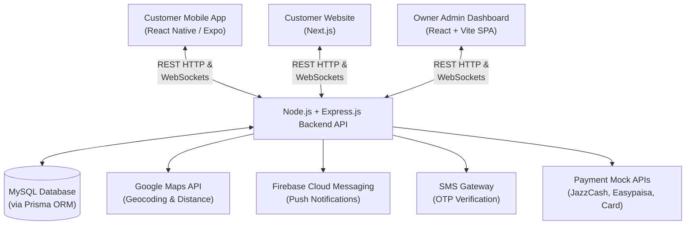

# System Architecture - Karachi Naseeb Baryani & Pulao UCP

This document details the architectural layout, communication patterns, tech stack integration, and key physical boundaries of the Karachi Naseeb Baryani & Pulao UCP online food ordering platform.

---

## 1. High-Level Component Layout

The platform employs a centralized backend API serving three client applications. All business logic, location-based delivery calculations, and payment tracking are executed on the backend to avoid logic duplication across clients.

---

## 2. Platform Tech Stack Details

| Layer | Component | Technologies | Configuration / Purpose |
|---|---|---|---|
| **API Backend** | Core Server | Node.js, Express.js, TypeScript | Serves all authenticated and public REST endpoints; maintains WebSocket server for order status updates. |
| | Database Access | Prisma ORM | Provides static type safety, migration histories, and relational queries for MySQL. |
| | Security | Helmet, CORS, express-rate-limit, Zod | Rate limiting, HTTP header hardening, CORS configuration, database error isolation, and schema validation. |
| **Clients** | Mobile App | React Native, Expo, TypeScript | Built for iOS and Android; uses Expo for push notifications and camera/location integrations. |
| | Website | Next.js, React, Tailwind CSS | Server-side rendered (SSR) pages optimized for public menu indexing and local SEO search terms. |
| | Admin Dashboard | React, Vite, Recharts, TypeScript | Single-page application (SPA) optimized for fast loading and order processing. |
| **Integrations** | Geo Services | Google Maps Geocoding & Places APIs | Resolves address locations to coordinates and determines eligibility. |
| | Payments | Mock integrations | Standardized webhook callbacks for JazzCash, Easypaisa, Safepay, and manual bank transfers. |
| | Notifications | Firebase Cloud Messaging (FCM) | Pushes real-time status update notifications directly to customer devices. |

---

## 3. Core Architectural Data Flows

### A. Location-Based Eligibility Flow
1. **Address Saved**: Customer picks address on map -> Website/Mobile gets latitude/longitude.
2. **Eligibility Request**: Client calls `POST /api/delivery/check-eligibility` with coordinates.
3. **Haversine Distance Check**: Backend calculates straight-line distance from shop coordinates:
   $$\text{Shop Lat} = 31.4475531,\ \text{Shop Long} = 74.2690347$$
   Using the Haversine formula:
   $$a = \sin^2(\Delta\text{lat}/2) + \cos(\text{lat}_1)\cdot\cos(\text{lat}_2)\cdot\sin^2(\Delta\text{long}/2)$$
   $$c = 2\cdot\text{atan2}(\sqrt{a}, \sqrt{1-a})$$
   $$\text{distance} = R\cdot c \quad (\text{where } R = 6371\text{ km})$$
4. **Checkout Gate**: If distance $\le 2.2\text{ km}$, checkout is allowed. Otherwise, checkout is blocked with an "address out of delivery zone" error.

### B. Real-Time Order Updates (Socket.io)
- **Establish Connection**: Client connects to backend WebSocket server and registers with user context.
- **Order Lifecycle Status Update**: 
  1. Admin changes order status from `ACCEPTED` to `PREPARING` via `PUT /api/owner/orders/:id/status`.
  2. The server processes database update, saves the change, and fires a Socket.io event: `orderStatusUpdate` containing the updated order JSON.
  3. Client receives the socket payload and immediately pushes order state updates to UI order tracker components.
- **FCM Push Notification**: If the user is on the mobile app, the server triggers a background notification payload to FCM for push delivery.

### C. Authentication and OTP Security Gates
- JWT access tokens expire in 15 minutes; refresh tokens are stored in the database to allow silent renewal.
- Authentication endpoints (register, login, password reset) have stricter rate-limiting thresholds (10 requests per 15 minutes per IP/account) to block brute-force attempts.
